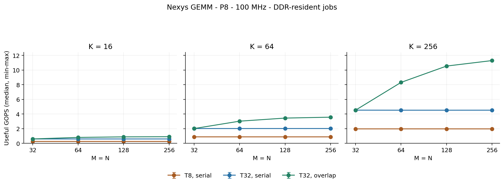

# Nexys GEMM

[](https://github.com/MihailoPesic/fpga-gemm-accelerator/actions/workflows/core.yml)

Signed `INT8` matrix multiplication with `INT32` accumulation on the Nexys A7-50T (`xc7a50ticsg324-1L`). An `8x8` output-stationary systolic array combines banked double-buffered BRAM, a four-slot AXI4 burst DMA, and a tagged overlap scheduler over `MIG`-backed DDR2 memory. Python loads matrices and validates returned outputs over `1 Mbaud` USB-UART. AMD `SmartConnect` and `MIG` provide the width/clock-domain bridge and DDR2 controller/PHY; compute, banking, DMA, scheduling, and packet/register RTL are implemented in this repository.

**[Watch the FPGA hardware demo](https://youtu.be/NxxY2GaKiKQ)**

### Start here
* **Key RTL:** [gemm_pe.sv](rtl/core/gemm_pe.sv) · [gemm_axi_burst.sv](rtl/memory/gemm_axi_burst.sv) · [gemm_tile_scheduler.sv](rtl/control/gemm_tile_scheduler.sv) · [gemm_ddr_overlap_job.sv](rtl/control/gemm_ddr_overlap_job.sv)
* **Architecture & design tradeoffs:** [docs/architecture.md](docs/architecture.md) · [docs/decisions.md](docs/decisions.md)
* **Measured board results & reports:** [results/README.md](results/README.md) · [docs/measurements.md](docs/measurements.md)
* **Scoped formal proofs (`Yosys 0.69`):** [formal/README.md](formal/README.md) · [results/formal/README.md](results/formal/README.md)

At `100 MHz`, a `256x256x256` job finishes in **`2.97001 ms` / `11.298` useful GOPS** (`88.3%` of the `12.8 GOPS` arithmetic peak, median of `30` runs). This includes all off-chip DDR2 tile loads, result writes, and the final AXI `B` write acknowledgement; host packing, UART transfers, and validation are timed separately ([measurements](docs/measurements.md)).

The measured build is `P8/T32`, four read slots, `1 Mbaud`, image `0x9d4beb4d`, supporting both serial (`MODE=0`) and overlapped (`MODE=1`) execution on the same bitstream. Board use currently requires a cold power-up; **DDR2 warm reset remains unqualified** ([status and limits](docs/status.md)).

## Design

```text
Control: Python -> USB-UART -> packets/registers -> scheduler

Load:    DDR2 -> MIG/SmartConnect -> read DMA -> A/BT banks
Compute: A/BT banks -> prefetch/skew -> 8x8 array -> C banks
Store:   C banks -> write DMA -> SmartConnect/MIG -> DDR2

DMA interface: 64-bit AXI, 100 MHz
MIG interface: 128-bit AXI, 50 MHz -> x16 DDR2, 200 MHz
```

The tagged scheduler owns two operand buffer sets (`A/BT`) and two result buffer sets (`C`). It reserves output storage before launching a microtile, prefetches inputs so DDR stalls cannot stall compute mid-tile, and holds results until write-back completes. `M` and `N` span `1..1024`; `K` spans `1..256`. Input padding and partial PE rows/columns are masked, and AXI byte strobes preserve `C` row padding. See [architecture](docs/architecture.md) and [module contracts](docs/README.md).

## Measured performance

`P=8`, signed `INT8 -> INT32`, `100 MHz`, `M=N=K=256`; `30` samples per configuration (inputs resident in DDR2 between repetitions; `T` is the macrotile reuse size).

| Configuration | Median job cycles | Latency (ms) | Useful GOPS |
| --- | ---: | ---: | ---: |
| `T8, serial` | `1,698,969.5` | `16.990` | `1.975` |
| `T32, serial` | `741,063.5` | `7.411` | `4.528` |
| `T32, overlap` | `297,001.0` | `2.970` | `11.298` |

Growing the macrotile from `T=8` to `T=32` cuts accepted AXI reads from DDR2 by `4x` (`524,288` to `131,072` 64-bit beats) and speeds up serial execution by `2.293x` (compute cycles and total written output bytes stay fixed, while larger tiles also coalesce `C` write bursts from `8,192` to `2,112`). Overlapping loads, compute, and stores across double-buffered banks adds `2.495x` (`5.720x` overall). Both `T8` and `T32` fit inside the exact same `20` BRAM36 equivalents (`16 RAMB36 + 8 RAMB18`). On `1024x1024x256`, overlap reaches `11.509 GOPS` (`46.648 ms`).



[Full comparison, traffic, and tail latency](docs/measurements.md) covers all 16 matched shapes (`1,440` jobs) and raw counters ([comparison.csv](results/comparison/comparison.csv)).

## Verification

| Check | Evidence |
| --- | --- |
| Arithmetic and interfaces | Exhaustive `65,536` `INT8` pairs, `1,056` integrated simulated jobs, channel stalls, protocol faults, and `8/8` injected RTL mutants caught. [Verification map](docs/verification.md) · [Summary](results/verification/README.md) |
| Board shape grid | `960` `T32` jobs + `480` `T8` jobs across 16 shapes (`30` samples/mode); every output and guarded allocation checked. [Record](results/board/README.md#full-shape-grid) |
| Maximum dimensions | `1024x1024x256` in both modes (`2,097,152` `INT32` outputs checked against `INT64` oracle). [Record](results/board/README.md#maximum-dimensions-1024x1024x256) |
| Repeatability | `592` continuous mixed jobs over `30.06` minutes (`550,634` outputs); zero mismatches or UART retries. [Record](results/board/README.md#30-minute-endurance-run) |
| Implementation | `100 MHz` routed setup/hold `+0.017 / +0.017 ns`; `17,026` LUTs, `20,882` FFs, `75` DSP48E1, `20` BRAM36 eq (`85.90%` slices). [Reports](results/implementation/README.md) |
| Scoped formal checks | `Yosys 0.69` inductive proof on the 4-entry read FIFO; bounded SAT checks on reduced scheduler (`32` cycles) and DMA row planner (`20` cycles). [Proof scope](results/formal/README.md) |

Earlier milestones and debug history are summarized in [docs/history.md](docs/history.md) and [docs/decisions.md](docs/decisions.md).

## Try the portable core

Linux/WSL: Python 3.12, `make`, and Icarus Verilog 12.0 (no Vivado or vendor IP required):

```sh
python3 -m venv .venv
.venv/bin/python -m pip install -r requirements-test.txt
.venv/bin/python scripts/test.py --only pe --build-dir build/core_smoke
```

Run the full portable regression and core mutation suite with `make lint test mutation PYTHON=.venv/bin/python`. [Testing](docs/testing.md) lists all module suites and optional `Yosys` formal checks.

## Build and use the FPGA

Use native Python and Vivado 2026.1 with Artix-7 support:

```text
python -m pip install -r requirements-host.txt
python scripts/build_ddr_gemm.py --stage sim --overlap --p 8 --t 32 --read-slots 4 --baud 1000000 --build-dir build/gemm_current
python scripts/build_ddr_gemm.py --stage bitstream --overlap --p 8 --t 32 --read-slots 4 --baud 1000000 --build-dir build/gemm_current
```

After both stages pass, connect J6 USB, keep JP1 in JTAG mode, close serial terminals, and switch the board OFF then ON. Program and run:

```text
python scripts/program_ddr_gemm.py --manifest build/gemm_current/build.json
python -m host.gemm --port COM11 --manifest build/gemm_current/build.json --mode 1 --m 5 --n 3 --k 9 --repeats 3 --retries 0 --output build/my_gemm_demo
```

Replace `COM11` with your board's serial port. The [Python API](docs/host-gemm.md#use-your-own-matrices) accepts custom `A`/`B` matrices, and [board instructions](docs/ddr-board.md) cover qualification workflows.

## Repository layout and open limits

| Path | Contents |
| --- | --- |
| `rtl/core`, `rtl/memory`, `rtl/control` | Systolic array, banked BRAM, AXI4 burst DMA, scheduler, registers, and UART framing |
| `platform/nexys_a7` | Board wrapper, timing/pin constraints, and MIG/SmartConnect generation setup |
| `host/gemm`, `tb`, `formal`, `scripts` | Host Python API, `cocotb` testbenches, Yosys formal harnesses, and build/benchmark scripts |
| `docs`, `results` | Architecture specs, design tradeoffs, curated plots, Vivado reports, and proof summaries |

**Known limits:** Post-route `100 MHz` timing closes at `+0.017 ns` setup/hold slack at `85.9%` slice occupancy (`XC7A50T`) after isolating a registered scalar fault predicate (`-2.029 ns` -> `-0.237 ns` -> `+0.017 ns`). Open items for a future revision include warm-reset DDR2 clock/CKE qualification, `K > 256` tiling, and widening timing margin.

Generated projects, environments, and bitstreams stay under ignored `build/`. The legacy root `accelerator nexys.xpr` belongs to the initial native-DDR bring-up; its `.srcs` directory still supplies the UART RTL and MIG config used by the build scripts. See [THIRD_PARTY.md](THIRD_PARTY.md), the [original v1 target](docs/specification.md), and the implemented [register contract](docs/ddr-registers.md).
