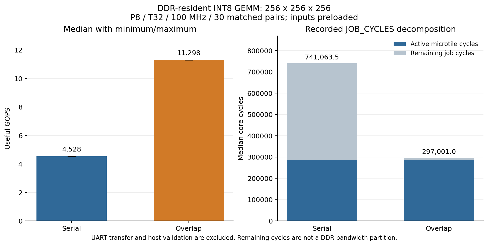

# Physical Nexys A7-50T Board Qualification

All physical measurements below ran on the Nexys A7-50T at `100 MHz` core clock and `1 Mbaud` USB-UART after cold power-up. Reported `JOB_CYCLES` spans validated `START` through the final AXI `B` write acknowledgement, including all off-chip DDR2 tile loads and result writes; host packing, UART transfers, and validation are timed separately.

## Dense `256x256x256` comparison

Image `0x9d4beb4d` (`P=8`, `T=32`, `READ_SLOTS=4`), `30` paired serial/overlap runs (`60` jobs, `3,932,160` checked `INT32` outputs, `23,616,000` allocation bytes, zero transport retries):

| Mode | Min cycles | Median cycles | Max cycles | Median useful GOPS |
| --- | ---: | ---: | ---: | ---: |
| Serial (`MODE=0`) | `740,890` | `741,063.5` | `741,391` | `4.528` |
| Overlap (`MODE=1`) | `296,951` | `297,001.0` | `297,058` | `11.298` |

## Maximum dimensions (`1024x1024x256`)

One job per mode on image `0x9d4beb4d`, checking all `2,097,152` `INT32` outputs and `9,437,952` allocation bytes against an independent `INT64` reference (`2,097,152` AXI read beats, `524,288` AXI write beats, `4,571,136` active compute cycles):

| Mode | Job cycles | DDR-job time (ms) | Useful GOPS |
| --- | ---: | ---: | ---: |
| Serial (`MODE=0`) | `11,863,408` | `118.634` | `4.525` |
| Overlap (`MODE=1`) | `4,664,784` | `46.648` | `11.509` |

## Full shape grid

- **`T32` (`0x9d4beb4d`):** `16` square and tail shapes (`30` samples per mode = `960` jobs, `15,981,960` checked `INT32` outputs).
- **`T8` serial baseline (`0xeed7b111`):** Same `16` shapes in `MODE=0` (`30` samples per shape = `480` jobs, `7,990,980` checked outputs).
- Full numerical breakdown: [../comparison/README.md](../comparison/README.md) and [../comparison/comparison.csv](../comparison/comparison.csv).

## 30-minute endurance run

- **Completed run (`0x9d4beb4d`):** `592` continuous mixed jobs across both modes over `30.06` host-paced minutes (`550,634` `INT32` output comparisons, fresh `C` sentinel initialization and full guarded allocation checks on every job, zero mismatches or UART retries).
- **Interrupted earlier attempt (host sleep incident):** An earlier endurance run stopped at job `384` (`381` completed jobs, `355,056` checked outputs) due to a `READ_REG` UART timeout three seconds after a Windows Modern Standby wake event. A read-only reconnect without reset or reprogramming confirmed the FPGA had finished job `384` cleanly (`READY` + `DONE`, all `64` outputs and `21,120` allocation bytes matched). Running the replacement 30-minute pass from zero under `scripts/keep_awake.py` completed cleanly.

## CLI and Python API smoke test

On `2026-10-08`, image `0x9d4beb4d` verified the host CLI (`M=5, N=3, K=9`, `MODE=1`, three runs: `479`, `480`, `480` cycles, `45` outputs) and the supplied-matrix Python API (`2x3 * 3x2`, `MODE=0`: `264` cycles, `MODE=1`: `265` cycles, zero retries).
