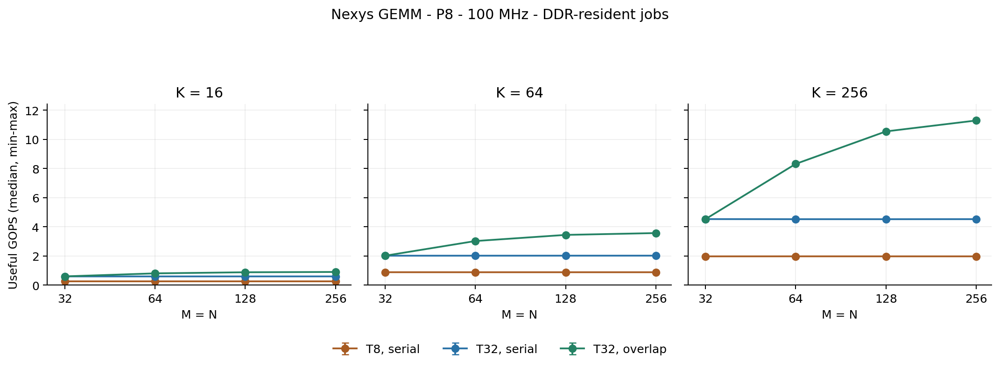

# Controlled Reuse and Overlap Comparison

Matched Nexys A7-50T board measurements across 16 matrix shapes (`30` samples per series, `1,440` total jobs) comparing three configurations at `P=8`, `100 MHz`, `READ_SLOTS=4`, and `1 Mbaud` UART:

- **Series A (`T8, serial`):** Build `0xeed7b111`, `MODE=0`, `480` jobs (`7,990,980` checked `INT32` outputs).
- **Series B (`T32, serial`):** Build `0x9d4beb4d`, `MODE=0`, `480` jobs.
- **Series C (`T32, overlap`):** Build `0x9d4beb4d`, `MODE=1`, `480` jobs (`960` total `T32` jobs, `15,981,960` checked outputs).

## Dense `256x256x256` summary

| Configuration | Median cycles | Latency (ms) | Useful GOPS | Accepted AXI read beats | Accepted AXI write beats | Compute cycles | Input wait cycles | Write stall cycles |
| --- | ---: | ---: | ---: | ---: | ---: | ---: | ---: | ---: |
| `T8, serial` | `1,698,969.5` | `16.990` | `1.975` | `524,288` | `32,768` | `285,696` | `988,903.5` | `16,384` |
| `T32, serial` | `741,063.5` | `7.411` | `4.528` | `131,072` | `32,768` | `285,696` | `222,368.5` | `4,224` |
| `T32, overlap` | `297,001.0` | `2.970` | `11.298` | `131,072` | `32,768` | `285,696` | `3,471.5` | `4,224` |

- `T8 -> T32` serial speedup: **`2.293x`** (accepted AXI reads from DDR2 drop `4.000x`, and `C` write bursts coalesce from `8,192` 4-beat bursts to `2,112` longer bursts).
- `T32` serial -> overlap speedup: **`2.495x`** (`5.720x` overall), reaching `88.3%` of the `12.8 GOPS` peak arithmetic ceiling with all DDR transfers included.
- Full 48-row dataset: [comparison.csv](comparison.csv).

## Figures

- Throughput: [useful_gops.png](useful_gops.png) / [useful_gops.pdf](useful_gops.pdf)
- Accepted AXI transfer volume: [transfer_volume.png](transfer_volume.png) / [transfer_volume.pdf](transfer_volume.pdf)
- Tail latency distribution: [tail_latency.png](tail_latency.png) / [tail_latency.pdf](tail_latency.pdf)
